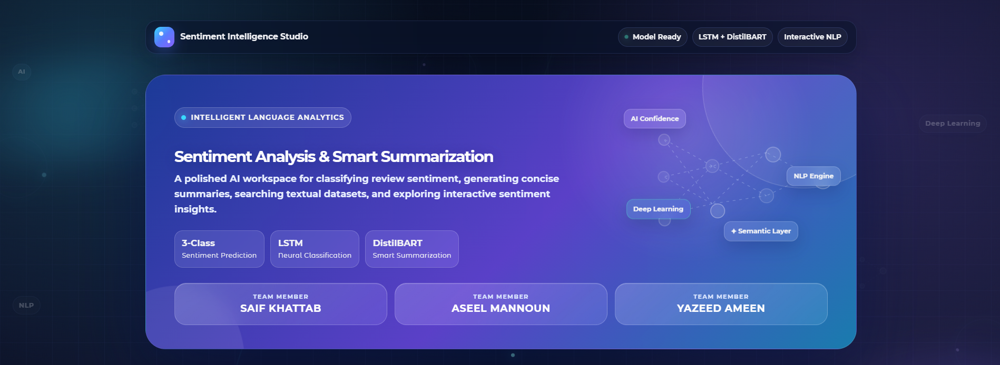
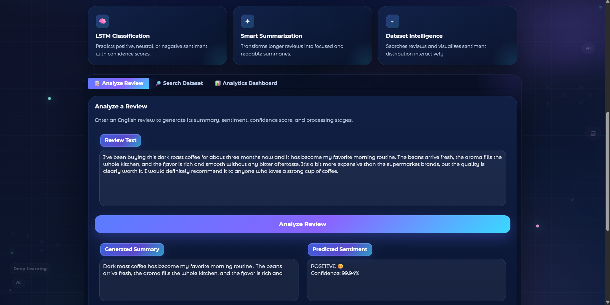

# Sentiment Analysis & Smart Summarization

An NLP web app that reads a product or service review and returns:

- **Sentiment**: positive, neutral, or negative, predicted by a trained **LSTM** model, with a confidence score and per-class probabilities
- **Summary**: a short summary of longer reviews, generated by **DistilBART** (`sshleifer/distilbart-cnn-12-6`)
- **Preprocessing steps**: the review shown at each stage (raw tokens → no punctuation → no stop words → lemmatized)

Every analyzed review is saved with its predicted sentiment, so the dashboard updates as people use the app.

🔗 **Live demo:** [Hugging Face Space](https://huggingface.co/spaces/saif2556/NLP-Sentiment-Analyzer)





---

## Features

| Tab | What it does |
|---|---|
| 📝 **Analyze Review** | Paste a review and get its sentiment, confidence, class probabilities, a summary, and the preprocessing steps. The review is saved for the dashboard |
| 🔎 **Search Dataset** | Search the original reviews dataset by keyword, with fuzzy matching for common terms and a list of your last 5 searches (kept per browser session) |
| 📊 **Analytics Dashboard** | A donut chart of the sentiment breakdown, filtered by keyword, for one of three sources: the **original dataset**, the **user reviews** analyzed in the app, or **both** |

## How it works

1. **Preprocessing.** This must match the preprocessing used in training.
   - Strip HTML tags, URLs, and emails
   - Expand negations (`don't` → `do not`, `can't` → `can not`, …)
   - Lowercase the text and remove punctuation and digits
   - Tokenize with NLTK and remove stop words, keeping `not`, `no`, `nor`, and `never` so negations still count
   - Lemmatize with WordNet
2. **Classification.** The tokenizer turns the text into a sequence, which is padded to the model's input length and passed to the LSTM. The label encoder maps the output back to a class name.
3. **Summarization.** Reviews longer than 15 words are summarized with DistilBART. Shorter reviews are returned unchanged. The DistilBART model is loaded only on the first request, so the app starts faster.

4. **Saving reviews.** Each analyzed review is appended to a JSONL file together with its predicted sentiment, confidence, and a timestamp. A `CommitScheduler` from `huggingface_hub` pushes that file to a private Hugging Face dataset every 2 minutes, and the app reloads all saved reviews when it starts, so they survive Space restarts.

## Saved user reviews

User reviews are kept separate from the original dataset. Their labels are the model's **predictions**, not star ratings, so mixing them into `Reviews.csv` would blur the original labels. The dashboard lets you view them on their own or together with the dataset.

To enable saving on a Hugging Face Space:

1. Create a Hugging Face access token with **Write** permission.
2. In the Space, open **Settings → Variables and secrets → New secret**, name it `HF_TOKEN`, and paste the token.
3. Restart the Space. The logs should show `Saving user reviews to dataset: ...`.

The reviews are stored in the private dataset `saif2556/sentiment-user-reviews` under `data/`. Change the target with the `USER_REVIEWS_REPO` environment variable.

Without `HF_TOKEN`, the app still works, but saved reviews are kept in memory only and are lost when the app restarts.

> The app tells users that analyzed reviews are saved and asks them not to include personal information. Saved reviews are not shown in the search results.

## Model & training

The full training pipeline is in [`training.ipynb`](training.ipynb). It was run on Google Colab.

| Setting | Value |
|---|---|
| Data | First 100,000 valid rows of `Reviews.csv` |
| Split | 68,000 train / 12,000 validation / 20,000 test (stratified, `random_state=42`) |
| Tokenizer | Keras `Tokenizer`, vocabulary 20,000, `<OOV>` token, fit on training data only |
| Sequence length | 111 tokens (95th percentile of training review lengths) |
| Architecture | Embedding (128) → LSTM (64, dropout 0.2) → Dense (64, ReLU) → Dropout (0.3) → Dense (3, softmax) |
| Parameters | 2,613,763 |
| Optimizer / loss | Adam / sparse categorical cross-entropy |
| Class imbalance | Balanced class weights (negative 2.22, neutral 4.16, positive 0.43) |
| Training | Batch size 128, up to 12 epochs, EarlyStopping (patience 3) and ReduceLROnPlateau. Training stopped at epoch 7 and kept the weights from epoch 4. |

## Results

These are the results recorded in the outputs of [`training.ipynb`](training.ipynb), evaluated on its held-out **test set (20,000 reviews)**:

| Class | Precision | Recall | F1-score | Support |
|---|---|---|---|---|
| Negative | 0.7241 | 0.7588 | 0.7410 | 2,998 |
| Neutral | 0.3583 | 0.6640 | 0.4655 | 1,604 |
| Positive | 0.9592 | 0.8650 | 0.9096 | 15,398 |
| **Macro avg** | 0.6805 | 0.7626 | **0.7054** | 20,000 |
| **Weighted avg** | 0.8757 | 0.8329 | 0.8487 | 20,000 |

**Accuracy: 83.29%**

Confusion matrix (rows = true class, columns = predicted class):

| | Pred. negative | Pred. neutral | Pred. positive |
|---|---|---|---|
| **Negative** | 2,275 | 450 | 273 |
| **Neutral** | 245 | 1,065 | 294 |
| **Positive** | 622 | 1,457 | 13,319 |

### Limitations

- **The dataset is imbalanced.** About 77% of the reviews are positive and only 8% are neutral. Class weights raised neutral recall to 0.66, but neutral precision is still low (0.36). Many positive reviews are predicted as neutral (1,457 of 15,398).
- **Accuracy alone is misleading here.** A model that always predicts "positive" would already reach about 77%. The macro F1 (0.71) is a better measure of how well the model handles all three classes.
- **The data is limited to food products.** The model was trained only on food reviews, so it may perform worse on other kinds of reviews.
- **User reviews carry predicted labels.** The "User reviews" view in the dashboard reflects what the model predicted, including its mistakes (most often on neutral reviews and on negations such as "not good"). Anyone using the app can add reviews, so this view is not curated.
- **DistilBART is used as-is.** It was not fine-tuned or evaluated on this dataset, so the summary quality has not been measured (for example with ROUGE).
- **The numbers may not reproduce exactly.** No TensorFlow random seed is set, so retraining can give slightly different results. Also, the copy of `Reviews.csv` in this repository differs slightly from the copy used during training, so re-running the notebook will produce a slightly different train/test split.

## Dataset

This project uses the **[Amazon Fine Food Reviews](https://www.kaggle.com/datasets/snap/amazon-fine-food-reviews)** dataset, collected by the [Stanford Network Analysis Project (SNAP)](https://snap.stanford.edu/data/web-FineFoods.html). It has 568,454 Amazon food reviews from October 1999 to October 2012.

The app uses the `Text`, `Summary`, and `Score` (1–5) columns of `Reviews.csv`. The scores are mapped to labels:

| Score | Sentiment |
|---|---|
| 1–2 | negative |
| 3 | neutral |
| 4–5 | positive |

The app loads up to 100,000 valid rows for search and the dashboard, and skips rows that are corrupted.

**Citation:** J. McAuley and J. Leskovec. *From amateurs to connoisseurs: modeling the evolution of user expertise through online reviews.* WWW, 2013.

> The dataset is included here for academic and educational use only. All rights to the review content belong to its original authors and sources.

## Project structure

```
├── app.py                       # Gradio app: preprocessing, inference, UI
├── training.ipynb               # Training & evaluation notebook (Colab)
├── assets/                      # Screenshots used in this README
├── user_reviews/                # Created at runtime for saved reviews (not committed)
├── lstm_sentiment_model.keras   # Trained LSTM model (Git LFS)
├── text_tokenizer.pkl           # Keras tokenizer fitted on the training text (Git LFS)
├── label_encoder.pkl            # Label encoder for the sentiment classes (Git LFS)
├── Reviews.csv                  # Reviews dataset for search and the dashboard (Git LFS)
└── requirements.txt
```

## Run locally

The model and data files are stored with **Git LFS**, so install it before cloning:

```bash
git lfs install
git clone https://github.com/khattabs691-dev/NLP-Sentiment-Analyzer.git
cd NLP-Sentiment-Analyzer

python -m venv venv
# Windows: venv\Scripts\activate    |    Linux/macOS: source venv/bin/activate

pip install -r requirements.txt
python app.py
```

Then open the local URL that Gradio prints, usually `http://127.0.0.1:7860`.

To save analyzed reviews to a Hugging Face dataset when running locally, set `HF_TOKEN` (and optionally `USER_REVIEWS_REPO`) as environment variables before starting the app.

> The first run downloads the NLTK data. The first summarization request downloads DistilBART (~1 GB).

## Tech stack

Python · TensorFlow / Keras · Hugging Face Transformers (PyTorch) · huggingface_hub · NLTK · pandas · Matplotlib · TheFuzz · Gradio

## Team

- **Saif Khattab**
- **Aseel Mannoun**
- **Yazeed Ameen**
